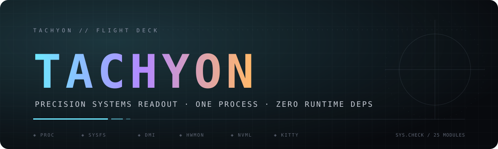

<div align="center">



<br>

### A cockpit-grade system fetch. One process. One pass.

<p>
  
  
  
</p>
<p>
  
  
  
  
</p>

<br>

</div>

> Read the instruments, not the manual. Tachyon is a system readout that treats your terminal like a flight deck: dense, deliberate, and gone in a single frame.

<br>

## ◈ What it is

Tachyon renders the state of the machine directly from the kernel's own surfaces. It walks `/proc`, `/sys`, DMI tables and hwmon, opens NVML only when it is present, and writes one composed frame. Nothing is shelled out to `uname`, `df`, `ip`, `systemctl` or `nvidia-smi`; there are no helper binaries, no daemons, no caches and no network calls.

It is designed for people who want the truth about their systems at a glance — and then want their prompt back.

<br>

## ◈ Feature set

| | |
|---|---|
| **25 modules** | system, compute, storage, network, processes and power, individually toggleable |
| **One process** | every value is collected in-process; no forks, no pipelines |
| **HUD layout** | two-column flight-deck composition with a `stack` fallback for narrow terms |
| **Reveal motion** | a short staged entrance, or silence with `--static` |
| **Configurator** | `--tui` toggles modules, glyph, layout, motion and albums, then saves |
| **Palette engine** | reads a TSV palette table and the active theme state; built-in Solitude fallback |
| **Artwork** | kitty graphics protocol with placement that never reflows text |
| **Album rotation** | `$XDG_DATA_HOME/tachyon/albums/<name>/*.png`, picked deterministically with `--seed` |
| **Image ingest** | JPEG/PNG conversion inside the binary — no ImageMagick, no shell |
| **Threshold colour** | capture warns once a metric actually means something |
| **Graceful absence** | no GPU, no battery, no hwmon, no NVML, no palette: the frame still renders |
| **No residue** | no config written unless you ask the configurator to save |

<br>

## ◈ Install

```sh
git clone https://github.com/mohamedsalahi/tachyon-fetch.git
cd tachyon-fetch
cargo build --release
install -Dm755 target/release/tachyon ~/.local/bin/tachyon
```

Or straight from the source tree:

```sh
cargo install --git https://github.com/mohamedsalahi/tachyon-fetch --locked
```

The crate is named `tachyon-fetch`; the installed command is `tachyon`. A recent stable Rust toolchain is the only build requirement.

<br>

## ◈ First frame

```sh
tachyon
```

```text
TACHYON // FLIGHT DECK · SIM                                                        SOLITUDE · DARK
pilot@tuf-a15
───────────────────────────────────────────────────────────────────────────────────────────────────
▸ SYSTEM ──────────────────────────────────────────────────────────────────────────────────────────
OS          NixOS 26.11 (x86_64)
Host        ASUS TUF Gaming A15
Kernel      6.16.0
Uptime      2h 41m
Session     wayland
Shell       fish 4.0.1
Terminal    kitty
Compositor  Umbriel (Wayland)
Load        0.42 0.51 0.47
▸ CORE ────────────────────────────────────────────────────────────────────────────────────────────
CPU        AMD Ryzen 7 (16)
GPU        NVIDIA GeForce RTX 4060 Laptop GPU
GPU util   37%
VRAM       3.2 / 8.0 GiB (40%)
Memory     4.6 / 15.0 GiB (31%)
Swap       0.0 / 8.0 GiB (0%)
Disk (/)   214 GiB / 1.0 TiB (21%)
Media      612 GiB / 1.4 TiB (43%)
Code       18 GiB / 256 GiB (7%)
IP         10.0.0.42
Link       wlan0 · 866 Mb/s
Processes  412
▸ POWER ───────────────────────────────────────────────────────────────────────────────────────────
Battery         87% [Charging]
Battery health  96%
CPU temp        58 °C
GPU temp        52 °C

NOTE  Simplify until it hurts, then stop.
```

<br>

## ◈ Command line

| Flag | Effect |
|---|---|
| `--demo` | render synthetic values instead of host reads |
| `--tui` | open the module and appearance configurator |
| `--plain` | no colour, no image |
| `--static` | disable the reveal animation |
| `--no-logo` | skip the kitty image |
| `--layout <hud\|stack>` | choose the composition |
| `--glyph <char\|random>` | section marker |
| `--album <name>` | pull artwork from an album |
| `--theme <name>` | override the active palette |
| `--variant <dark\|light>` | force the palette variant |
| `--seed <n>` | deterministic layout, glyph and artwork choice |
| `--logo <path>` | explicit PNG for the kitty graphics protocol |
| `--palettes <path>` | alternate palette table |
| `--quotes <path>` | alternate note pool |
| `--config <path>` | alternate module/appearance config |
| `--state <path>` | alternate theme state file |
| `--list-themes` | print the palette table |
| `--convert <src> <dst>` | convert an image to PNG (used by album ingest) |
| `-h`, `-V` | help and version |

<br>

## ◈ The configurator

```sh
tachyon --tui
```

```text
space  toggle module          g  cycle glyph
j / k  move                   l  cycle layout
a      add photo to album     m  cycle motion
b      cycle album            s  save config
q      quit
```

The panel edits the same plain-text configuration the renderer consumes. Nothing is written until `s`.

<br>

## ◈ Configuration

`~/.config/tachyon/fetch.conf`

```ini
# only these modules render; omit the line for all of them
enabled = os,host,kernel,uptime,session,cpu,memory,swap,disk_root,disk_media,gpu_util,gpu_vram,battery,cpu_temp,gpu_temp

glyph  = ◆
layout = hud
motion = reveal
image  = /home/you/Pictures/board.png
album  = night
```

| Resource | Default |
|---|---|
| config | `$XDG_CONFIG_HOME/tachyon/fetch.conf` |
| palettes | `$XDG_DATA_HOME/tachyon/palettes.tsv` |
| quotes | `$XDG_CONFIG_HOME/tachyon/quotes.txt` |
| state | `$XDG_STATE_HOME/tachyon/theme` |
| logo | `$XDG_DATA_HOME/tachyon/logo.png` |
| albums | `$XDG_DATA_HOME/tachyon/albums` |

Environment overrides: `TACHYON_FETCH_CONFIG`, `TACHYON_FETCH_PALETTES`, `TACHYON_FETCH_QUOTES`, `TACHYON_FETCH_STATE`, `TACHYON_FETCH_LOGO`, `TACHYON_FETCH_ALBUMS`.

A palette row is twelve tab-separated fields:

```text
name  variant  bg  fg  dim  accent  accent2  ok  warn  error  layout  motion
```

If no palette table is present, Tachyon falls back to its own Solitude palette. An active Omarchy theme state is honoured when available.

<br>

## ◈ Modules

| Group | Identifiers |
|---|---|
| **System** | `os` `host` `kernel` `uptime` `session` `shell` `terminal` `compositor` `load` |
| **Core** | `cpu` `gpu` `gpu_util` `gpu_vram` `memory` `swap` |
| **Storage** | `disk_root` `disk_media` `disk_code` |
| **Network** | `ip` `link` |
| **Process** | `processes` |
| **Power** | `battery` `battery_health` `cpu_temp` `gpu_temp` |

<br>

## ◈ Design notes

- **Direct collection.** `/proc` and `/sys` are parsed in place. DMI and hwmon are discovered, not assumed.
- **NVML on demand.** The library is opened with `dlopen`; if the driver or the symbol is absent, GPU telemetry silently degrades.
- **One write.** The frame is composed in memory and emitted once, so a slow terminal never tears the layout.
- **Contained unsafe.** `unsafe` is limited to the NVML ABI, termios and the terminal bindings.
- **Nothing persistent except intent.** Renders do not write state; only an explicit configurator save does.
- **No network.** Ever.

<br>

## ◈ Status

Tachyon is in active development. The collection layer is stable; the instrument panel is still being refined. Bug reports and focused patches are welcome.

<br>

<div align="center">

`╺━━━━━━━━━━━━━━━━━━━━━━━━━━━━━━━━━━━━━━━━━━━━━━━━━━━━━━━━━━━━━━━━━━━━━━━━━━━━━━━━━━━╸`

**MIT** © 2026 Mohamed Salahi

<sub>Built for cold mornings and warm terminals.</sub>

</div>
